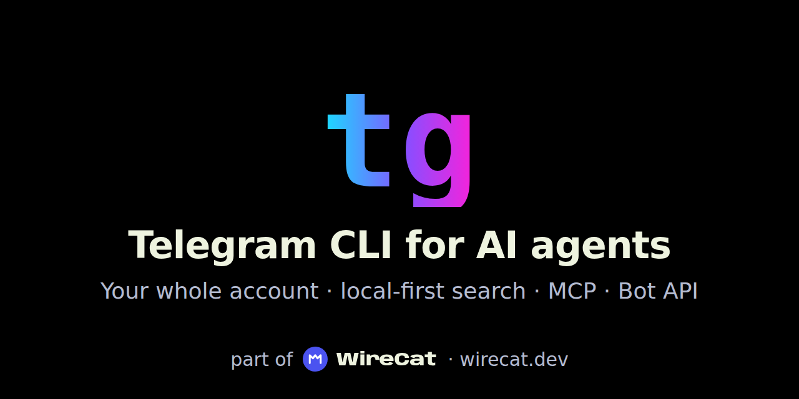

<p align="center">
  
</p>

# tg: Telegram CLI for AI agents

<p align="center">
  Full control of your Telegram from the terminal. Your own account and your bots, every chat and its whole
  history, for you and for Claude Code, Codex, Cursor or any AI agent.
</p>

<p align="center">
  <a href="https://wirecat.dev/en/docs/tg">Docs</a> ·
  <a href="https://github.com/WireCatLabs/tg-cli/blob/main/docs/recipes.md">Examples</a> ·
  <a href="https://discord.gg/DebENqbRrJ">Discord</a>
</p>

<p align="center">
  <a href="https://www.npmjs.com/package/@wirecat/tg-cli"></a>
  <a href="https://github.com/WireCatLabs/tg-cli/actions/workflows/ci.yml"></a>
  <a href="https://www.npmjs.com/package/@wirecat/tg-cli"></a>
  <a href="https://github.com/WireCatLabs/tg-cli/blob/main/LICENSE"></a>
</p>

- **Full control.** Connect your personal account and write as yourself, or connect any bot. Chats, groups, channels,
  contacts, files and the whole Bot API, all from one tool.
- **Deep search that finds what others miss.** Every message you ever had, searched on your computer. It forgives
  typos, finds synonyms and matches by meaning. Voice messages and files are searched too.
- **Groups that run themselves.** Auto-replies, moderation by your rules, unanswered questions, who joined and left,
  activity analytics.

## What you get

- **Never miss what matters.** One command shows who is waiting for your answer in every chat. Nothing gets marked
  as read.
- **Find any message in seconds.** "When did we agree on the venue with Alice?" gives you the date and the message,
  even with no internet.
- **Answer when you can't.** Auto-replies by your own rules, to the people you choose, while you sleep or travel.
- **Keep order in your groups.** Spam, floods and foreign links removed by your rules. Questions nobody answered,
  new members, a weekly summary.
- **Understand any media.** Voice messages become text on your computer, with no Premium. Text is pulled from files
  and scans. All of it is searchable.
- **Know who owes what.** "What did I promise this week, and what am I waiting for?" One answer across every chat.
- **See the whole picture.** Link a person's Telegram and MAX accounts, add WhatsApp, Google Calendar and Meet, and ask
  about a person or a project across all of them.

```text
You:    What did I promise anyone in the last three days?
Agent:  (runs tg personal review 'date>3d': 12 chats)
        I owe
        · Alice Example: the invoice by Friday. "Alice Example", 24.09
        Waiting on others
        · Bob Sample: the mock-up by 25.09. Not in "Design" yet
You:    Remind Bob about the mock-up.
Agent:  Draft: "Hi Bob, how is the mock-up going?" Send it?
You:    Yes.
```

*Invented people, illustrative output.*

## Why tg

- **Your data never leaves your computer.** `tg` talks only to Telegram. There is no WireCat server and no account
  with us. Your history is kept in a local database that only your user can read.
- **The official Telegram API, with your own app.** `tg` logs in like the Telegram desktop app does, as one more of
  your devices. It keeps its pace under Telegram's limits, so bulk work stays within them.
- **Search that goes all the way back.** Download a chat's full history once, then search it with no network. It finds a
  word with a typo, its other forms and its synonyms, a question you half remember, whole discussions by meaning, and
  asks Telegram's own server search at the same time.
- **Safe to give to an agent.** You decide what an agent may do: read only, write only to the chats you list, at most
  so many messages an hour (30 by default). Text from other people is marked as untrusted, so an agent never takes a
  message it read as an instruction. Every send is logged.
- **Ready for any agent.** A skill for agents with a terminal, an MCP server with ready prompts for Claude Desktop and
  Cursor, and a secure link for ChatGPT and Claude in the browser.
- **Free and open source.** Apache 2.0, on macOS, Linux and Windows.

How it compares with other Telegram tools: [the comparison](https://wirecat.dev/en/docs/tg/compare).

## Quick start

```sh
npm install -g @wirecat/tg-cli    # or: bun add -g @wirecat/tg-cli
tg personal setup                 # register your Telegram app, log in by QR code, install the agent skill
tg personal inbox                 # other people's unread messages, in every chat
```

It takes about five minutes. `personal` is a name you choose for this account. You can add `work` or any other later.
`tg personal setup` registers your own Telegram app at [my.telegram.org](https://my.telegram.org/apps), logs in by QR
code and installs the skill for Claude Code, Codex and Gemini CLI.

You need Node.js 22.19+ or 24+, or Bun. Try it without installing: `npx @wirecat/tg-cli --help`.

More: [installation](https://wirecat.dev/en/docs/tg/installation), with Windows and pnpm.

## Use it with your agent

Ask in plain words. The agent picks the commands.

> *"Use tg. What came in since this morning, and who is waiting for my answer?"*
> *"Use tg. Which questions in Hiking has nobody answered?"*
> *"Use tg. Find the PDF Alice sent about the lease."*

- **Claude Code, Codex, Gemini CLI** and other agents with a terminal run `tg` themselves. `tg skill install --for all`
  teaches them how.
- **Claude Desktop, Cursor** and other MCP apps connect to `tg personal mcp serve`. It comes with ready prompts:
  `/catch-up`, `/review`, `/reply`, `/find`, `/open-tasks`.
- **ChatGPT or Claude in the browser** reach it through your own tunnel, after a login with a one-time code.

```sh
tg personal mcp add claude-code --allow-writes   # or: codex
tg personal mcp config                           # the entry for Claude Desktop, Cursor and others
```

More: [agents and MCP](https://wirecat.dev/en/docs/tg/mcp) · [from the browser](https://wirecat.dev/en/docs/tg/remote) ·
[recipes](https://wirecat.dev/en/docs/tg/recipes)

## What it can do

### Your account

Everything you do in the Telegram app: read and send, reply, forward, edit, pin, react, polls, scheduled and silent
messages, files, photos, videos and voice messages, contacts, devices.

```sh
tg personal messages list "Book club" --limit 20
tg personal messages send "Book club" "Call at 3?" --reply-to <id>
tg personal messages send me "Call mum" --at-time 2h   # a reminder in Saved Messages
tg personal review --new                               # everything new since the last review
```

More: [using tg](https://wirecat.dev/en/docs/tg/usage) · [one person](https://wirecat.dev/en/docs/tg/people)

### Search

```sh
tg personal search all "lease agreement"                        # messages and notes, best match first
tg personal search messages 'from:"Alice Example" invoice date>30d'
tg personal search messages 'What time does the export run?' --discover   # a question you half remember
tg personal search conversations 'moving to the country'        # discussions close in meaning
tg personal search messages "contract" --offline                 # never leaves your computer
```

Filter by person, chat, date, file, link and tag. Save a search and run it again. Count matches by chat, person or day.

More: [search](https://wirecat.dev/en/docs/tg/search) · [the query language](https://wirecat.dev/en/docs/tg/query-language) ·
[the local store](https://wirecat.dev/en/docs/tg/archive)

### Groups you run

```sh
tg personal review chat:Hiking --unanswered      # questions nobody answered in 24 hours
tg personal chats events "Hiking" "time>=7d"     # who joined, left, was added or removed, and by whom
tg personal chats rules set "Hiking" links report # your moderation rules: links, forwards, floods
tg personal stats chats show "Hiking"            # activity
```

Members, admins, join requests, invite links, forum topics and a daily member snapshot are commands too.

More: [groups you run](https://wirecat.dev/en/docs/tg/groups) · [auto-replies](https://wirecat.dev/en/docs/tg/replies)

### Voice, files and scans

```sh
tg personal messages transcribe "Book club" <id>   # a voice message as text, on your computer
tg personal attachments extract                    # text from saved files
```

More: [files and media](https://wirecat.dev/en/docs/tg/attachments)

### A bot

`tg <profile> bot` works with any bot through the official Bot API: all 185 methods, next to ready commands for
sending, replies and updates.

More: [bots](https://wirecat.dev/en/docs/tg/bot)

### With your other sources

`tg` keeps what it reads in the same local database as the other WireCat tools, such as WhatsApp, MAX and Google
Calendar. `tg personal search all` finds a word in messages, notes, calendar events and meeting transcripts at once.
Mail has its own search in memo. `tg personal contacts link` records that two accounts are one person.

More: [WireCat](https://wirecat.dev)

## How it works

- **One more device.** `tg` speaks MTProto, the protocol of Telegram's own apps, through an app you register. The
  login is kept in your system keyring, never in a file or a command line.
- **A local copy.** Every message `tg` reads is saved on your computer. History downloads in the background, page by
  page. A stop loses nothing, and the next run goes on from there. `tg` knows which stretches of a chat it holds in
  full, so "not found" never hides a gap.
- **Staying current.** `tg personal server install` keeps the copy up to date as a system service.
- **Polite to Telegram.** One request pace per account, shared by every command, agent and background job. Short
  waits from Telegram are waited out, long ones stop the run instead of retrying.
- **No double sends.** When the connection drops during a send, `tg` says the outcome is unknown and gives a repeat
  that Telegram does not deliver twice.
- **Made for scripts.** `--json` gives the same shape for every command, and each kind of failure has its own exit
  code.

More: [limits and waits](https://wirecat.dev/en/docs/tg/limits) · [output for scripts](https://wirecat.dev/en/docs/tg/cli-contract)

## Settings and permissions

Each account (profile) has its own settings: what an agent may do, which chats it may write to, how many messages an
hour.

```sh
tg personal config set permissions.messages readonly   # this profile changes no messages
```

More: [permissions](https://wirecat.dev/en/docs/tg/permissions) · [profiles](https://wirecat.dev/en/docs/tg/profiles)

## Security

Your login is in the system keyring, and no command takes a password, code or phone number as an argument. The local
copy is readable only by your user. Text from other people cannot control your terminal or your agent.

More: [security](https://wirecat.dev/en/docs/tg/security) · Report a vulnerability: [SECURITY.md](https://github.com/WireCatLabs/tg-cli/blob/main/SECURITY.md)

## When something goes wrong

```sh
tg personal doctor            # what is set up, without connecting
tg personal doctor --online   # check that the login works
```

More: [troubleshooting](https://wirecat.dev/en/docs/tg/troubleshooting) · Ask on [Discord](https://discord.gg/DebENqbRrJ) ·
Bugs go to this repository's issues.

## Documentation

Everything is on [wirecat.dev/en/docs/tg](https://wirecat.dev/en/docs/tg). The same pages are in [docs/](https://github.com/WireCatLabs/tg-cli/blob/main/docs/index.md).

## Development

```sh
pnpm install && pnpm test
```

More: [architecture](https://github.com/WireCatLabs/tg-cli/blob/main/docs/dev/ARCHITECTURE.md) · [testing](https://github.com/WireCatLabs/tg-cli/blob/main/docs/dev/TESTING.md)

Pull requests, bug reports and ideas go to [issues](https://github.com/WireCatLabs/tg-cli/issues).

## Part of WireCat

`tg` is one of the [WireCat](https://wirecat.dev) tools: open-source, local-first command-line tools that give AI
agents your context from messengers, mail, calendars and documents. Each one works on its own.

## License

[Apache 2.0](https://github.com/WireCatLabs/tg-cli/blob/main/LICENSE)
