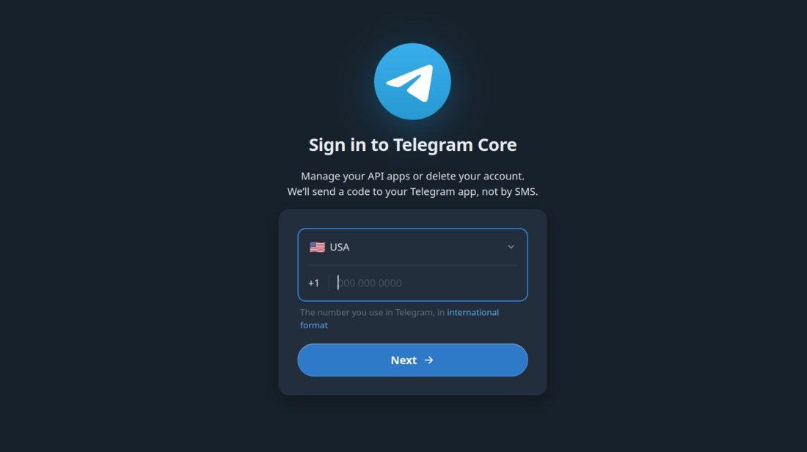
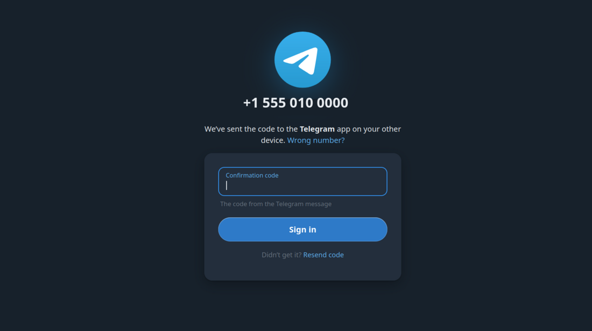
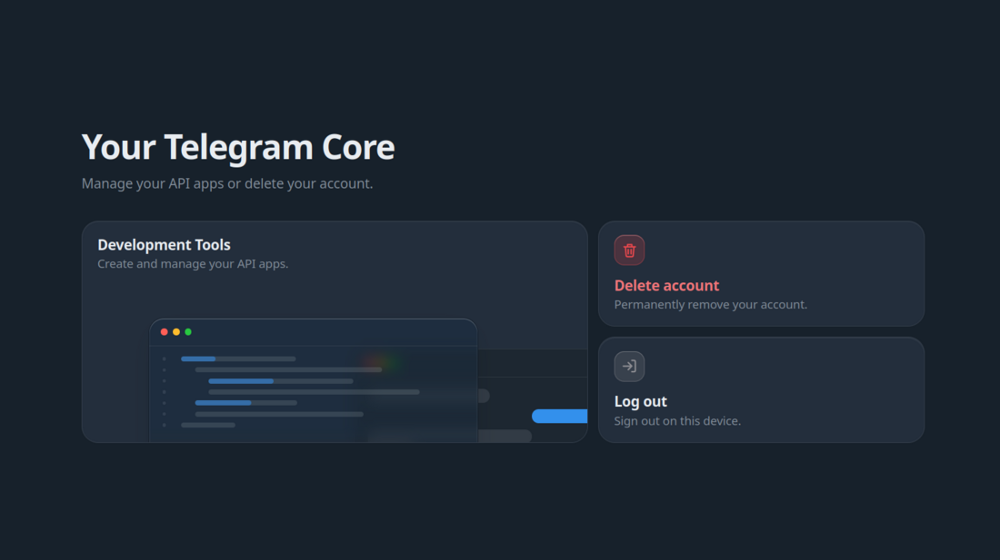
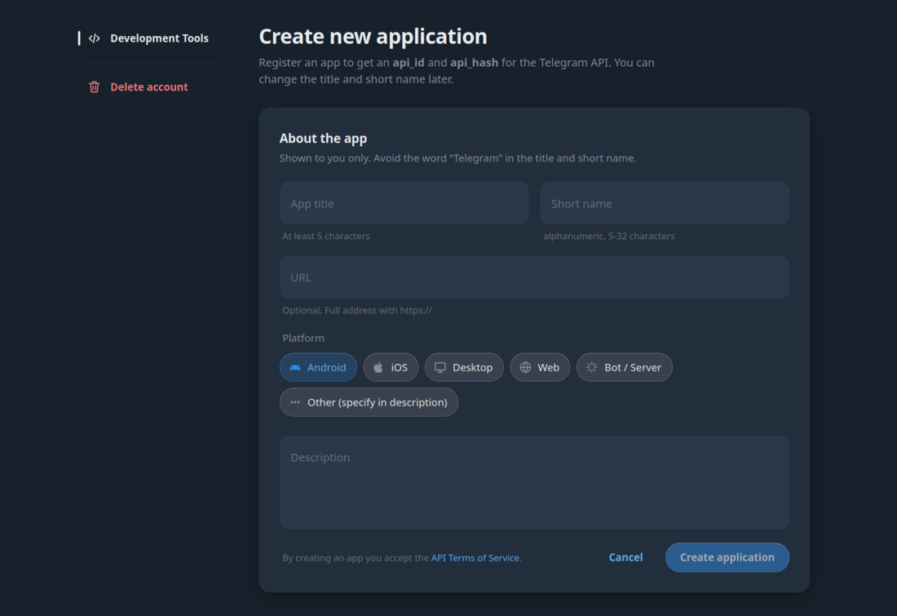
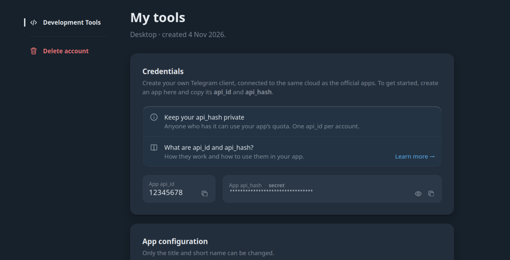
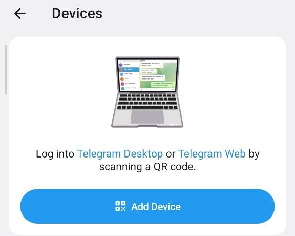
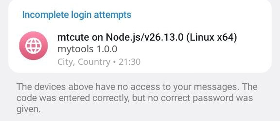

# Login, sessions and profiles

Read this page when you connect `tg` to your Telegram account for the first time, when you add a
second account, or when `tg` says you are not logged in. At the end you know how to log in, how to
check who you are logged in as, how to log out, and where `tg` keeps what it needs to stay logged in.

First, the words this page uses:

- **Session**: the login of `tg` on this computer. Telegram issues it when you log in, and lists it in
  the Telegram app as one more device. `tg` keeps it in a file. Whoever has that file can read your
  chats, so treat it like your password.
- **App** (`api_id` and `api_hash`): two values from [my.telegram.org](https://my.telegram.org/apps)
  that identify the program to Telegram. Each user registers their own app once; `tg` can do it for
  you.
- **Keyring**: the password store of your operating system. `tg` keeps the app values there.
- **Profile**: a name for one login on this computer, with its own session, app and settings. Every
  command that uses an account names it, so you pick one name at setup (`tg personal setup`) and use
  it from then on ([profiles](#profiles)).

Do not confuse `tg personal session` with `tg personal account sessions`. `tg personal session` is the login of `tg` itself;
`tg personal account sessions` lists every other device and app logged in to your account.

## First run

`tg personal setup` guides a first run through the app and the session, checks five chats and offers an agent
skill. Allow about five minutes; history downloads are a separate step. Run it in a terminal. Use
`tg personal setup --app browser` for manual app registration or `--method phone` for a phone login.
`tg personal session start` remains the command for login alone, including resuming an interrupted login.
Setup checks an existing session and does not silently log in again if it is rejected.

## The app from my.telegram.org

Every user registers their own app. Telegram gives one app per phone number, so an app id is never
shared or built into `tg`. You need it once per profile; `tg personal session start` asks only when the profile
has none.

Two ways to get it:

- **`--app browser`** opens [my.telegram.org/apps](https://my.telegram.org/apps). Log in there,
  create an app if you have none (any title and short name, platform Desktop), and paste
  `App api_id` and `App api_hash` when `tg` asks. The hash is not shown as you type. This is the
  default for `tg personal session start`.
- **`--app auto`** fills in the site for you. It asks your phone number and the code my.telegram.org
  sends you as a message in Telegram, then reads your app, or creates one if you have none. The site
  has no API, so `tg` follows its web form; a change on Telegram's side can break this. `--app
  browser` still works then. This is the default for `tg setup`.

The app is stored only after Telegram has accepted the login.

### Create the app by hand

Use these steps with `--app browser`, or when `--app auto` fails. You do this once per Telegram account.

1. **Sign in at [my.telegram.org](https://my.telegram.org/apps).** Choose your country, type your phone number and press **Next**.

   

   Telegram sends a confirmation code as a message in your Telegram app, not by SMS. Type it on the page and press **Sign in**. Never give this code to anyone, and never type it into an agent chat.

   

2. **Open Development Tools** and choose **Create new application**.

   

   Fill in the form. The title needs at least 5 characters. The short name is letters and digits only, 5 to 32 characters. Avoid the word "Telegram" in both. Choose a platform, for example **Desktop**. The URL and the description are optional. Then press **Create application**.

   

3. **Copy `api_id` and `api_hash`** from the Credentials section. Keep the hash private: anyone who has it can use your app's quota.

   

4. **Give both values to `tg`** when it asks for `App api_id` and `App api_hash`. The hash is not shown as you type.

The phone number and the app values in these screenshots are examples.

## Logging in

```sh
tg personal session start  # a QR code in the terminal
tg personal session start phone  # a phone number, the code Telegram sends, and your 2FA password
tg personal session start phone --sms  # the same, asking Telegram for the code by SMS
```

**QR:** scan the code in the Telegram app, as the next section describes. The code is renewed while you
wait.

**Phone:** type the number in international format, then the login code. If the account has a
cloud password (2FA), `tg` asks for it without showing what you type. With `--app auto`, the phone
number is asked only once. The code usually arrives in the Telegram app; `--sms` asks for an SMS
instead, but Telegram chooses, and `tg` says which way it was sent. When Telegram has no SMS for the
account, `tg` says so and asks for the code from the app.

After either, Telegram lists a new device in the app's list of sessions.

```text
Logged in as <your name> (@<username>, id <id>) — profile personal.
Session:  ~/.local/share/tg-cli/sessions/personal.session
App keys: in the keyring
Next:     tg personal chats list · tg personal server install to keep the archive current
```

### When an agent runs the login

Your AI agent can start the login for you. Without a terminal, `tg` prints the QR code as plain
text, and the agent pastes it into the chat for you to scan:

```sh
tg personal session start qr
```

The agent runs it in the background, because the command waits for the scan and a shell tool shows
nothing until the command ends. It reads the output and pastes the QR block into the chat as a code
block, exactly as printed. When Telegram renews the code, a new block is printed: the agent pastes
it and says the old one expired. With `--json`, each code is also one line on stderr,
`{"event":"qr","qr":{"text":…,"expires_at":…,"scan":…}}`. Once the code is scanned, tg says
`scan accepted, finishing sign-in`, with `--json` as
`{"event":"progress","step":"scanned","message":…}`: Telegram can take ten seconds or more to finish.

The code is drawn for a dark terminal theme. Without a terminal this works only when the profile
already has its app and the account has no 2FA password: anything else you have to type yourself.
A program that shows the questions in its own window, such as WireCat Desktop, runs
`tg personal session start phone --json --answer-stdin`: each question is a `needs` line on stderr,
answered with one line on stdin.
`tg personal setup` works the same way. Login is not offered as an MCP tool: an agent that has
only MCP asks you to run the command, or runs it through its shell.

### Link a device with a QR code

Telegram calls this linking a desktop device. `tg` shows a QR code in the terminal and you scan it with the Telegram app on your phone. Use Telegram's own scanner, not the camera app.

#### Android

1. Open Telegram and go to **Settings**, then **Devices**.
2. Press **Add Device** and allow camera access if Telegram asks.
3. Point the camera at the QR code in your terminal.



#### iPhone and iPad

1. Open Telegram and go to **Settings**, then **Devices**.
2. Press **Link Desktop Device** and allow camera access if Telegram asks.
3. Point the camera at the QR code in your terminal.

If your account has a two-step password (2FA), `tg` asks for it after the scan. The terminal does not show what you type.

**Incomplete login attempts.** If you scanned the code but did not enter the 2FA password, the attempt appears in **Devices** under **Incomplete login attempts**. It has no access to your messages. Finish the login in `tg`, or terminate the attempt in the same list.



## Check and log out

```sh
tg personal account show     # who this profile is logged in as
tg account list              # every profile on this computer, and the account each is logged in as
tg personal account sessions list  # every device and app logged in to the account; ends nothing
tg personal session end      # log out on Telegram's side, and delete the session file here
```

`tg personal session end` ends the session **on Telegram's side too**: the device disappears from the list in
the app. It does not delete the app id and hash from the keyring, and it leaves the local store as
it is.

To forget a profile altogether, use `tg personal account remove --keep-data` or `--delete-data`. It logs the session
out the same way, then deletes the profile's app id and hash, its proxy password, its bots' history sessions and
what cli-core keeps for it. `--keep-data` leaves its messages searchable in the store; `--delete-data` deletes them.
The bot token of a same-named bot profile stays: a bot is a separate account.

## How long a session lives

Until it is ended: by `tg personal session end`, from the list of devices in a Telegram app, or by Telegram
itself once the session has gone unused for longer than the account's limit for inactive sessions
(`authorization_ttl_days` in
[Telegram's API](https://core.telegram.org/method/account.setAuthorizationTTL)), which the apps let
you set in the list of devices. A profile that runs every day never reaches it. When a session has
ended, every command answers "not logged in, or the session was ended" with exit code `4`; log in
again with `tg personal session start`
([what to do when the session was ended](troubleshooting.md#not-logged-in-or-the-session-was-ended--run-tg-session-start)).

## Profiles

A profile is a separate login: its own session, app, settings, recipients and runs. It is named by
**the first word**, not by an option:

```sh
tg personal chats list     # profile "personal"
tg work chats list         # profile "work"
export TG_PROFILE=work     # the same for the whole shell session
```

**The first word is the profile when it is not a command.** A profile therefore cannot be called
`chats`, `messages` or any other command word; `tg personal session start` refuses such a name. Names are
letters, digits, dot, dash and underscore, starting with a letter or a digit.

The order, first match wins: the first word, then `TG_PROFILE`. With
none of them, a command that uses an account stops with exit code `2` and lists the profiles on this
computer; with none there yet, it says to run `tg personal setup`. `tg` never picks one, not even the
only one. Commands that use no account run without a profile: `--help`, `--version`, `commands`,
`skill show`, `account list` and `config show`.

A word that is not a command and has no command after it is an error that says so:

```text
"nonsense" is not a command, so it was read as a profile name — and no command followed it.
```

**`TG_PROFILE_LOCK` pins a process to one profile.** Set it where an agent runs, and a first word or
`TG_PROFILE` naming any other profile is refused (exit code `5`). Without it, an agent could pick a
profile with fewer limits.

What each profile is for, and how a profile works with a bot: [profiles and bots](profiles.md).

## Where the parts are kept

| What | Where |
|---|---|
| the session | `sessions/<profile>.session` in the state directory |
| the app id and hash | the OS keyring, service `tg-cli`, entry `<profile>:api` |
| the app id and hash, with no keyring | `credentials.json` in the settings directory |
| the app id and hash, for CI | `TG_API_ID` and `TG_API_HASH`; they win over the keyring |

The directories are listed in [where files go](installation.md#where-files-go).

On a machine with no keyring (a container, often), the app goes into `credentials.json` beside the
settings, and `tg` says so once on stderr.

> ⚠ **`TG_CONFIG_DIR`, `TG_STATE_DIR` and `TG_CACHE_DIR` move the keyring entry too.** With any of
> them set, the service name includes the settings directory. A login made without them is invisible
> with them, and the other way round. Set them always, or never.

> ⚠ **On Linux the keyring is reached through `XDG_RUNTIME_DIR`.** cron, ssh and some MCP clients
> start `tg` without it, and every command then says the app credentials were not found "although it
> has logged in on this machine". **Do not log in again**: that adds another device and does not fix
> the environment. Set `XDG_RUNTIME_DIR`
> ([app credentials not found after a login](troubleshooting.md#no-telegram-app-credentials-found--although-it-has-logged-in-on-this-machine)).

## Next

- [Read your first chats](usage.md)
- [Settings, and the order they resolve in](configuration.md)
- [What reaches the disk, and what never does](security.md)
